<p align="center"></p>

<h1 align="center">Tezgah</h1>

<p align="center"><i>tezgâh</i> — Turkish for workbench. A terminal for working with AI coding agents.</p>

Tezgah keeps your projects in a sidebar and the sessions you run in each one under it. Every [Claude Code](https://claude.com/claude-code) session tells you what it's doing — working, waiting for you, done — and lists the subagents it has running, so you can keep several going and still know where to look. It runs on macOS, Windows and Linux.

> **Early version.** This is a rewrite of the first Tezgah (a macOS-only Swift app, kept in [tezgah-legacy](https://github.com/itsyunusacar/tezgah-legacy)) into something smaller that runs everywhere.

## What it does

- **Projects and sessions.** A project is a folder; sessions live under it. A session is usually one Claude Code conversation, or a plain shell.
- **Live status, no setup.** Claude Code reports its state to the terminal (OSC 7501). Tezgah shows it on each session — *Working*, *Needs you*, *Done* — with a badge for the ones waiting on you and a notification when you're elsewhere.
- **Allow or Deny from the sidebar.** When Claude asks for a permission, answer it without switching to the session.
- **Subagents.** While Claude runs subagents, the session lists each one and what it's doing right now.
- **Conversations that resume.** Each Claude session is pinned to its conversation, so quitting and reopening Tezgah picks up where you left off. ⇧⌘O reopens any past conversation.
- **Split panes.** Put a shell or a dev server next to Claude in the same session.
- **Changes.** The session's diff, against its base branch or uncommitted. Click a line to leave a note, then send all notes to Claude in one message.
- **Worktree sessions.** A session can get its own git branch and folder (`<repo>.worktrees/<branch>`) so parallel agents don't touch each other's files. Merge it back from the session's menu.
- **Usage limits.** Your Claude plan's 5-hour and weekly limits at the bottom of the sidebar.
- Light and dark, Geist type, a quick switcher, and keyboard shortcuts for everything.

## Install

Download the latest build for your system from [Releases](https://github.com/itsyunusacar/tezgah/releases):

- **macOS:** `Tezgah-<version>-arm64.dmg` (Apple silicon) or `-x64.dmg` (Intel). Builds aren't notarized yet: the first time, right-click Tezgah in Applications and choose *Open*.
- **Windows:** `Tezgah-Setup-<version>-x64.exe`.
- **Linux:** `Tezgah-<version>-x86_64.AppImage` (make it executable and run it) or the `.deb`.

You need [Claude Code](https://claude.com/claude-code) installed as `claude` for Claude sessions. Shell sessions work without it.

## Keyboard shortcuts

On Windows and Linux, plain Ctrl+letter keys belong to the shell, so Tezgah uses Ctrl+Shift.

| Action | macOS | Windows / Linux |
| --- | --- | --- |
| New Claude session / shell session | ⌘T / ⇧⌘T | Ctrl+Shift+T / Ctrl+Shift+N |
| New session in a worktree | ⌥⌘T | Ctrl+Alt+Shift+T |
| Open folder / recent conversations | ⌘O / ⇧⌘O | Ctrl+Shift+O / Ctrl+Shift+H |
| Go to session | ⌘P | Ctrl+Shift+P |
| Next session that needs you | ⌘J | Ctrl+Shift+J |
| Allow / Deny | ⇧⌘↩ / ⇧⌘⌫ | Ctrl+Shift+Enter / Ctrl+Shift+Backspace |
| Split right / down | ⌘D / ⌥⌘D | Alt+Shift+= / Alt+Shift+- |
| Changes | ⇧⌘D | Ctrl+Shift+G |
| Close pane / session | ⌘W / ⇧⌘W | Ctrl+Shift+W / Ctrl+Alt+Shift+W |
| Session 1–9 | ⌘1 … ⌘9 | Alt+1 … Alt+9 |
| Copy / paste | ⌘C / ⌘V | Ctrl+Shift+C / Ctrl+Shift+V |

## Build from source

Needs Node 22+ (and, on Linux, the usual build tools for native modules).

```sh
git clone https://github.com/itsyunusacar/tezgah.git
cd tezgah
npm install
npm run dev          # run with hot reload
npm test             # unit tests
npm run dist         # installers for your platform, in dist/
```

Electron, [xterm.js](https://xtermjs.org) and [node-pty](https://github.com/microsoft/node-pty), with React for the interface.

## Privacy

Tezgah has no telemetry and no account. It makes one kind of network request: to show your plan limits, it reads Claude Code's login (the macOS Keychain item `Claude Code-credentials`, or `~/.claude/.credentials.json` elsewhere) and calls `https://api.anthropic.com/api/oauth/usage`, the endpoint Claude Code's `/usage` uses. That endpoint is undocumented and may stop working.

It reads `~/.claude/projects` to resume conversations, list recent ones and follow subagents. Your projects and sessions are saved in Tezgah's own settings folder.

Tezgah is independent and not affiliated with Anthropic. Claude and Claude Code are trademarks of Anthropic.

## License

[MIT](LICENSE)
