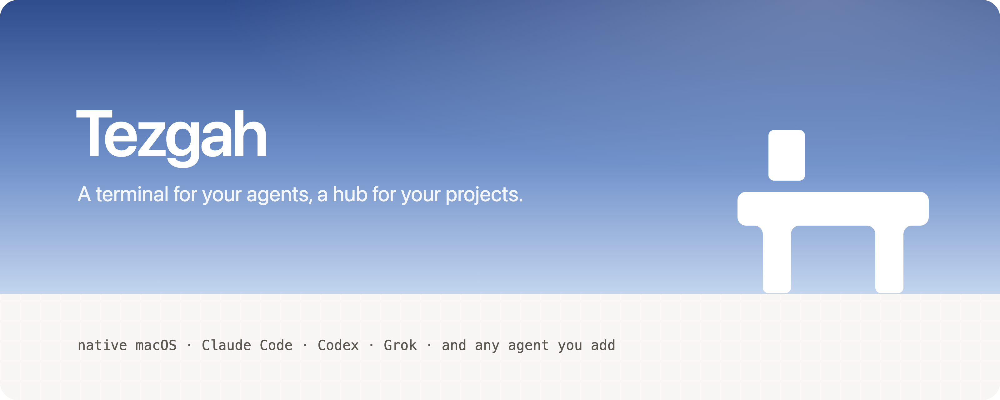
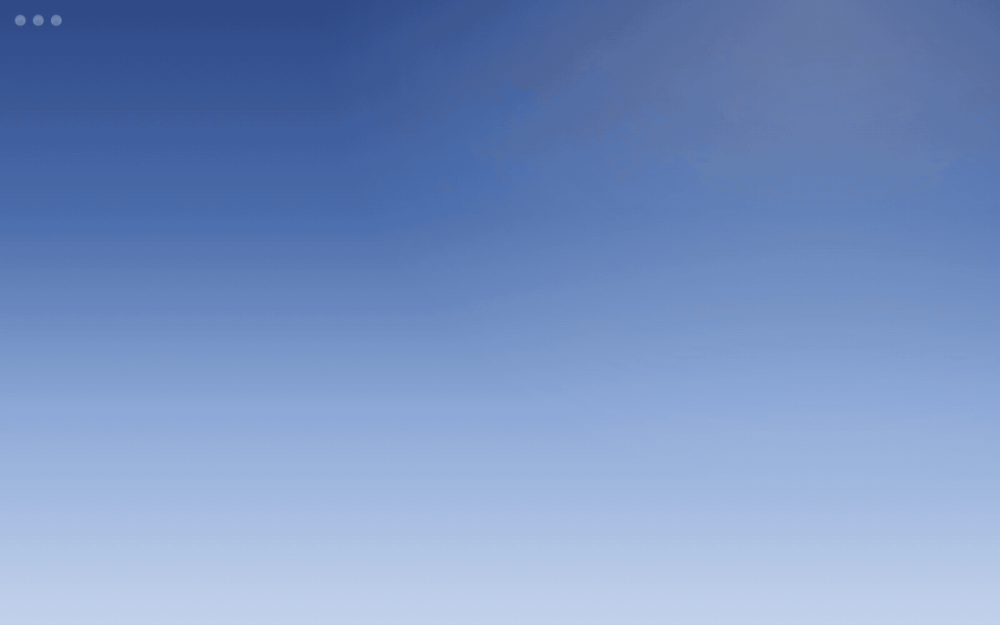
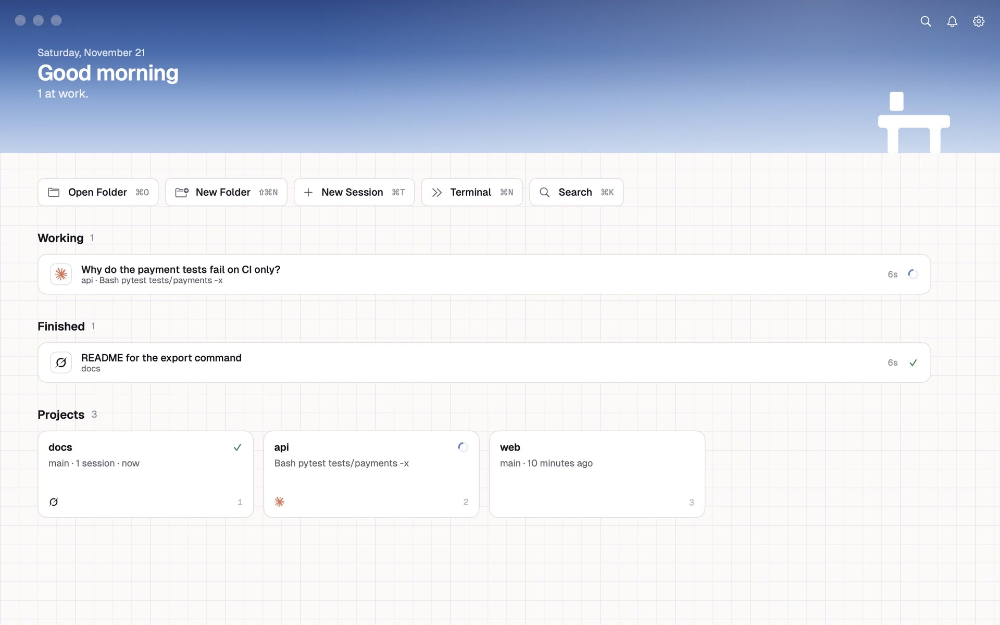
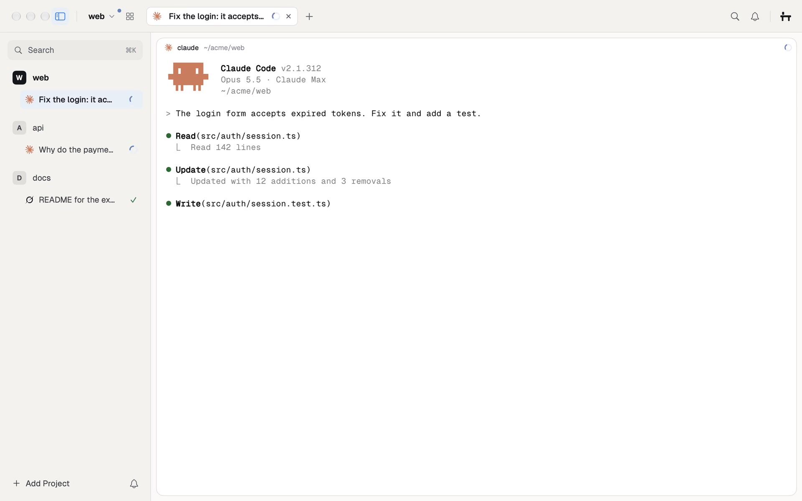
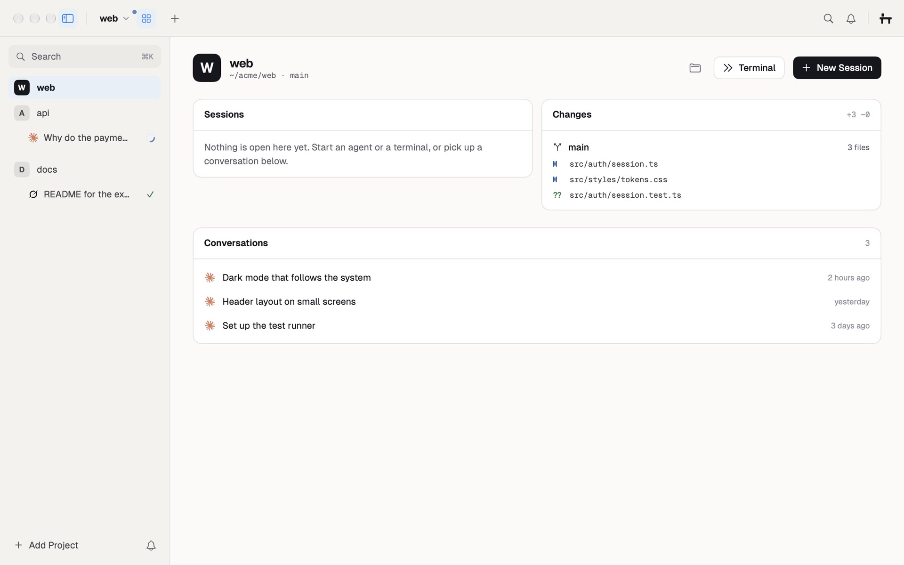
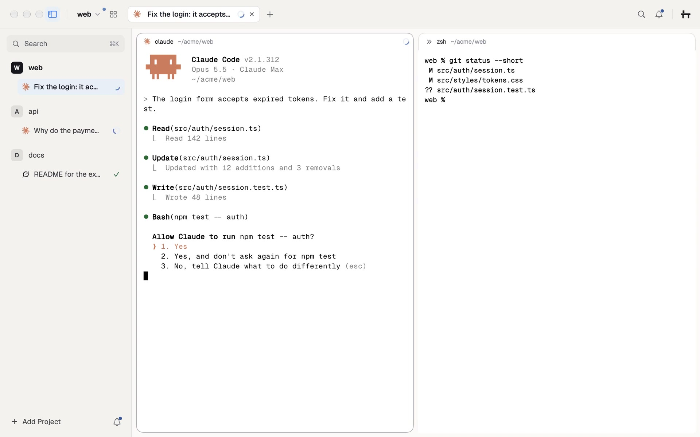

<p align="center"></p>

<p align="center">
  <a href="https://github.com/itsyunusacar/tezgah/releases/latest"></a>
  
  
  <a href="LICENSE"></a>
</p>

<p align="center"><b>English</b> · <a href="README.tr.md">Türkçe</a> · <a href="https://tezgah.itsyunusacar.com">Website</a></p>

Tezgah (*tezgâh*, Turkish for workbench) is a native Mac terminal for working with AI coding agents. Every project you work in sits in one window with the sessions running in it, and every agent in them says what it is doing: working, waiting for you, done. Start an agent in another project without leaving the one you are in, and come back tomorrow to the same conversations.

**Tezgah is in beta.** It gets updates often; tell us what breaks in [Issues](https://github.com/itsyunusacar/tezgah/issues).

<p align="center"></p>

<p align="center"><sub><a href="docs/media/demo.mp4">Watch in full quality</a> · 32 seconds</sub></p>

## Download

**[Tezgah for macOS](https://github.com/itsyunusacar/tezgah/releases/latest)** · macOS 15 or later · Apple silicon and Intel · free, no account.

Unzip it and move Tezgah to Applications. The build isn't notarized by Apple yet, so the first time, right-click Tezgah and choose *Open*. After that it updates itself.

You bring the agents: [Claude Code](https://claude.com/claude-code), [Codex](https://developers.openai.com/codex/cli), [Grok](https://x.ai/cli), or any other command-line agent. Shell sessions work without any of them.

## One window for every project

<p align="center"></p>

- **Home** opens first: who is waiting for you, who is working, who has finished, across all your projects.
- **The strip** beside a session lists every project with its sessions and their state. It keeps the order you give it.
- **Start anywhere.** The new session picker (⌘T) starts an agent in any project, in a tab of its own or beside the session you are in.
- **Answer from where you are.** A pill in the bar counts who is waiting; ⌘J takes you to the next one.

## Agents

<p align="center"></p>

| | Starts from the picker | State | Returns to its conversation |
| --- | --- | --- | --- |
| **Claude Code** | yes | reports it itself | yes |
| **Grok** | yes | reports it itself | yes |
| **Codex** | yes | through a hook for that run | yes (new, little tested) |
| **Anything else** (Aider, OpenCode, Gemini CLI, Cursor Agent…) | once added in Settings › Agents | read from what it does on screen | starts fresh |

Tezgah never edits an agent's own settings. Where it adds a hook, the hook is passed for that one run.

## Conversations stay with the project

<p align="center"></p>

Each project has a board (⇧⌘B): its open sessions, what changed in its git working tree, and every conversation its agents have had in that folder. Click one to pick it up where it stopped.

Quit Tezgah with agents open and they are there when you return: each pane starts its agent again, in the conversation it was in, when you open its session. First messages and one-off commands are never typed a second time.

## A terminal first

<p align="center"></p>

- Drawn by [Ghostty](https://ghostty.org)'s renderer: fast, with ligatures, true colour and the keyboard protocols modern tools expect.
- Split panes (⌘D, ⇧⌘D) that share the space evenly and tidy themselves into a grid when there are many.
- 16 themes in light and dark, find in scrollback (⌘F), a ⌘K palette for everything.
- Right-click a folder in Finder › *Open in Tezgah*; make it your default terminal for scripts and `ssh://` links.
- English and Turkish.

## Shortcuts

| | |
| --- | --- |
| New session · New terminal | ⌘T · ⌘N |
| Split right · down · Arrange in a grid | ⌘D · ⇧⌘D · ⇧⌘G |
| Next / previous pane | ⌥⌘→ · ⌥⌘← |
| Next / previous session | ⌃⇥ · ⌃⇧⇥ |
| Next agent waiting | ⌘J |
| Search everything · Quick switch | ⌘K · ⌘P |
| Projects strip · Project board · Home | ⌘0 · ⇧⌘B · ⇧⌘H |

## Privacy

Tezgah sends nothing anywhere: no analytics, no account. It asks for two permissions, notifications and the Finder action, and works without either.

## Build from source

Tezgah is Swift (AppKit and SwiftUI) with terminals drawn by libghostty ([libghostty-spm](https://github.com/Lakr233/libghostty-spm)) over a pty Tezgah owns, so it can read and answer OSC 7501, the protocol agents report their state with.

```sh
brew install xcodegen
xcodegen generate
xcodebuild -project TezgahMac.xcodeproj -scheme Tezgah -configuration Debug -derivedDataPath build/DD build
open "build/DD/Build/Products/Debug/Tezgah Dev.app"
```

The debug build is called Tezgah Dev and keeps its own data, so it runs beside an installed Tezgah.

- `Sources/TezgahCore`: the OSC 7501 parser, the layout tree, the workspace file, what comes back after a restart, and how a silent agent's state is read. Unit tested.
- `Sources/Tezgah`: the app: pty, panes, store, views.
- `scripts/check.sh` runs the unit tests, then starts the app and drives it with real clicks. `--agents` also starts the agents on your Mac; `--shots` renders every screen to `build/shots`.
- `scripts/demo/record.sh` records the video above from the real app.
- `scripts/release.sh` builds, signs and packs a release.

Data lives in `~/Library/Application Support/Tezgah/mac/workspace.json` (`Tezgah Dev/workspace.json` for the debug build); `--workspace <dir>` keeps it elsewhere.

## License

[MIT](LICENSE). Geist and Geist Mono are under the [SIL Open Font License](Sources/Tezgah/Resources/Fonts/OFL-Geist.txt).
