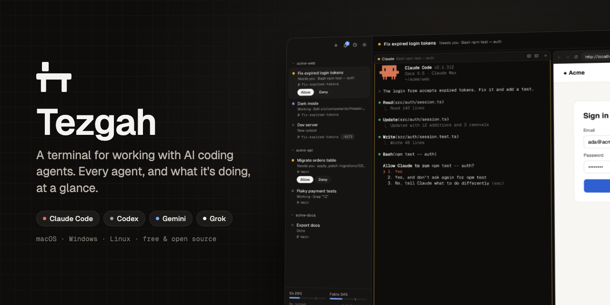
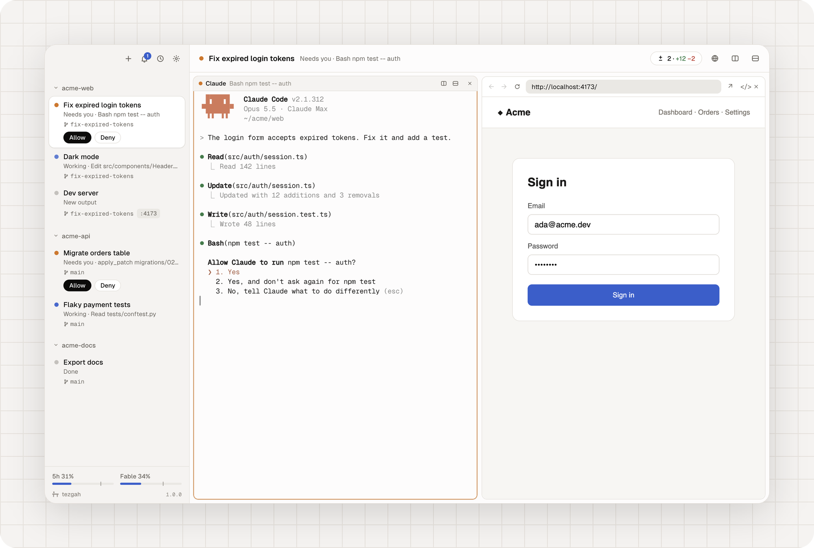

<p align="center"></p>

<p align="center">
  <a href="https://github.com/itsyunusacar/tezgah/releases"></a>
  <a href="https://github.com/itsyunusacar/tezgah/actions/workflows/ci.yml"></a>
  
  <a href="LICENSE"></a>
</p>

<p align="center"><b>English</b> · <a href="README.tr.md">Türkçe</a></p>

**Tezgah 1.0** is out. Tezgah (*tezgâh*, Turkish for workbench) is a terminal for working with AI coding agents. Your projects sit in a sidebar with the sessions you run in each one, and every agent in them — [Claude Code](https://claude.com/claude-code), Codex, Gemini, Grok and others — shows what it's doing: working, waiting for you, done. Keep several going and still know where to look.

<p align="center"></p>

<p align="center"><sub><a href="docs/images/demo.mp4">Watch in full quality</a></sub></p>

## Download

| | |
| --- | --- |
| **macOS** | [Apple silicon (.dmg)](https://github.com/itsyunusacar/tezgah/releases) · [Intel (.dmg)](https://github.com/itsyunusacar/tezgah/releases) |
| **Windows** | [Installer (.exe)](https://github.com/itsyunusacar/tezgah/releases) |
| **Linux** | [AppImage](https://github.com/itsyunusacar/tezgah/releases) · [.deb](https://github.com/itsyunusacar/tezgah/releases) |

Use it as your everyday terminal too: open folders with Tezgah from Finder's *Open With* (or *Open in Tezgah* in Windows Explorer), and make it your default terminal in Settings so shell scripts and `ssh://` links open in it. Builds aren't signed yet. On macOS, the first time, right-click Tezgah in Applications and choose *Open*; on Windows, choose *More info → Run anyway*. You need [Claude Code](https://claude.com/claude-code) for Claude sessions; shell sessions and other agents work without it. Tezgah is free and has no account.

## Every agent at a glance

<p align="center"></p>

- **Live status, no setup.** Claude Code reports its state itself; Codex through hooks Tezgah passes when you run it (Codex asks you to trust them once); Gemini, Grok, Aider, OpenCode and others are read from what they do. Each session says *Working*, *Needs you* or *Done*, with what it's doing right now.
- **Answer without switching.** Allow or deny a permission request right from the sidebar. A ring marks the pane that needs you, the bell counts what you missed, and the menu bar icon shows who's waiting.
- **Subagents** listed under their session, each one followable as it works.
- **What's running where:** each session's git branch, the ports its programs listen on (click to open) and its pull request.
- **Conversations that resume.** Sessions are pinned to their Claude conversation, and shell panes keep their screen, across relaunches.
- **Organize:** split panes, saved layouts, worktree sessions so parallel agents don't collide, drag to reorder, pin, archive.
- **Plan limits** for Claude and Codex at the bottom of the sidebar, and the context and tokens of each Claude session in its header.

## A browser your agents can use

Open your dev server beside the terminal. Agents read the page as text with element refs, click, fill forms, press keys, take screenshots, and check the console and network, so they can try what they built. It keeps working while you look at another session. Claude gets these tools automatically; any agent can use them through the [`tezgah` command](#the-tezgah-command) or [MCP](#agents-and-the-browser).

## Review, commit, ship

<p align="center"></p>

See every change the session made, click a line to leave a note, and send all notes to Claude in one message. Then commit, push and open a pull request from the same panel.

## Made to be at home in

<p align="center"></p>

A short tour on first launch; Turkish and English; light and dark; find in terminal; drop or paste files and screenshots as paths; SSH sessions; your own commands in the + menu and the quick switcher; every shortcut changeable; a quiet note when a new version is out.

## Keyboard shortcuts

On Windows and Linux, plain Ctrl+letter keys belong to the shell, so Tezgah uses Ctrl+Shift. Change any of them in Settings → Keyboard Shortcuts.

| Action | macOS | Windows / Linux |
| --- | --- | --- |
| New Claude session / shell session | ⌘T / ⇧⌘T | Ctrl+Shift+T / Ctrl+Shift+N |
| New session in a worktree | ⌥⌘T | Ctrl+Alt+Shift+T |
| Open folder / recent conversations | ⌘O / ⇧⌘O | Ctrl+Shift+O / Ctrl+Shift+H |
| Go to session | ⌘P | Ctrl+Shift+P |
| Next session that needs you | ⌘J | Ctrl+Shift+J |
| Allow / Deny | ⇧⌘↩ / ⇧⌘⌫ | Ctrl+Shift+Enter / Ctrl+Shift+Backspace |
| Split right / down | ⌘D / ⌥⌘D | Alt+Shift+= / Alt+Shift+- |
| Changes | ⇧⌘D | Ctrl+Shift+G |
| Close pane / session | ⌘W / ⇧⌘W | Ctrl+Shift+W / Ctrl+Alt+Shift+W |
| Session 1–9 | ⌘1 … ⌘9 | Alt+1 … Alt+9 |
| Copy / paste | ⌘C / ⌘V | Ctrl+Shift+C / Ctrl+Shift+V |
| Find | ⌘F | Ctrl+Shift+F |
| Notifications / latest unread | ⌘I / ⇧⌘U | Ctrl+Shift+I / Ctrl+Shift+L |
| Open browser | ⇧⌘L | Ctrl+Shift+Y |

## Agents and the browser

Claude sessions started by Tezgah get its tools automatically, through an MCP config passed to that session only (your Claude settings aren't changed; turn it off in Settings). Ask Claude to "open the app and check the sign-in form" and it can:

| Tool | What it does |
| --- | --- |
| `browser_open` | Open a URL in the session's browser pane and wait for it to load |
| `browser_snapshot` | The page as text, each link, button and field with a ref (`e12`) |
| `browser_click`, `browser_fill`, `browser_type`, `browser_press`, `browser_select`, `browser_hover`, `browser_scroll` | Act on the page with real mouse and keyboard input |
| `browser_screenshot` | See the page or one element as an image |
| `browser_wait` | Wait for text, a selector, a URL or the page to load |
| `browser_console`, `browser_network` | What the page logged, and the requests it made (failed ones too) |
| `browser_eval`, `browser_navigate` | Run JavaScript; back, forward, reload |
| `terminal_read`, `terminal_send`, `terminal_split` | Read or type into other panes, or start a dev server beside you |
| `tezgah_list`, `tezgah_notify` | Sessions and panes; notify you |

**Other agents** can use the same tools. Any agent that runs shell commands can use the `tezgah` command below with no setup. For agents that speak MCP, add `tezgah mcp` as a server, for example:

```toml
# Codex: ~/.codex/config.toml
[mcp_servers.tezgah]
command = "tezgah"
args = ["mcp"]
```

```json
// Gemini CLI: ~/.gemini/settings.json
{ "mcpServers": { "tezgah": { "command": "tezgah", "args": ["mcp"] } } }
```

The `tezgah` command exists only inside Tezgah's terminals, so these servers start when the agent runs in Tezgah.

## The `tezgah` command

Every terminal inside Tezgah has a `tezgah` command. It needs nothing installed; it runs on Tezgah's own runtime and talks to the app over a socket only your user can open.

```sh
tezgah browser open http://localhost:5173    # open your app beside the terminal
tezgah browser snapshot                      # the page as text, with refs
tezgah browser fill text=Email ada@example.com
tezgah browser click "text=Sign in"          # a ref (e12), a CSS selector, or text=…
tezgah browser wait --text "Welcome"
tezgah browser screenshot                    # prints the PNG's path
tezgah browser console --errors              # also: network --failed, eval <js>, press Enter
tezgah notify --title Build "tests passed"   # notification, ring and panel entry
tezgah status working "deploying"            # this pane's status in the sidebar
tezgah split down -- npm run dev             # a new pane beside this one, running a command
tezgah new --shell --dir ~/code/api -- make  # a new session
tezgah send --enter "run the tests again"    # type into this session's Claude
tezgah read --lines 50                       # what a pane shows
tezgah list                                  # sessions and panes
tezgah run "Dev server"                      # one of your custom commands
```

`tezgah help` lists everything.

## Build from source

Needs Node 22+ (and, on Linux, the usual build tools for native modules).

```sh
git clone https://github.com/itsyunusacar/tezgah.git
cd tezgah
npm install
npm run dev          # run with hot reload
npm test             # unit tests
npm run e2e          # end-to-end tests
npm run dist         # installers for your platform, in dist/
```

Electron, [xterm.js](https://xtermjs.org) and [node-pty](https://github.com/microsoft/node-pty), with React for the interface.

## Privacy

Tezgah has no telemetry and no account. It makes two kinds of network request. To tell you about new versions, it asks GitHub for this repository's latest releases at launch and every six hours (Settings → Check for updates turns this off; nothing is ever installed by itself). To show your plan limits, it reads Claude Code's login (the macOS Keychain item `Claude Code-credentials`, or `~/.claude/.credentials.json` elsewhere) and calls `https://api.anthropic.com/api/oauth/usage`, the endpoint Claude Code's `/usage` uses. That endpoint is undocumented and may stop working.

For Codex limits it reads the last rate-limit report in Codex's own session logs (`~/.codex/sessions`); nothing is sent anywhere. Other agents (Gemini CLI, Cursor, OpenCode) don't keep their limits on your computer, so Tezgah can't show them.

It reads `~/.claude/projects` to resume conversations, list recent ones and follow subagents. Your projects and sessions, and the last screen of each shell pane, are saved in Tezgah's own settings folder. When the GitHub CLI is installed, Tezgah runs `gh pr view` in your projects to show their pull requests; that uses your own `gh` login.

Tezgah is independent and not affiliated with Anthropic. Claude and Claude Code are trademarks of Anthropic.

## License

[MIT](LICENSE)
