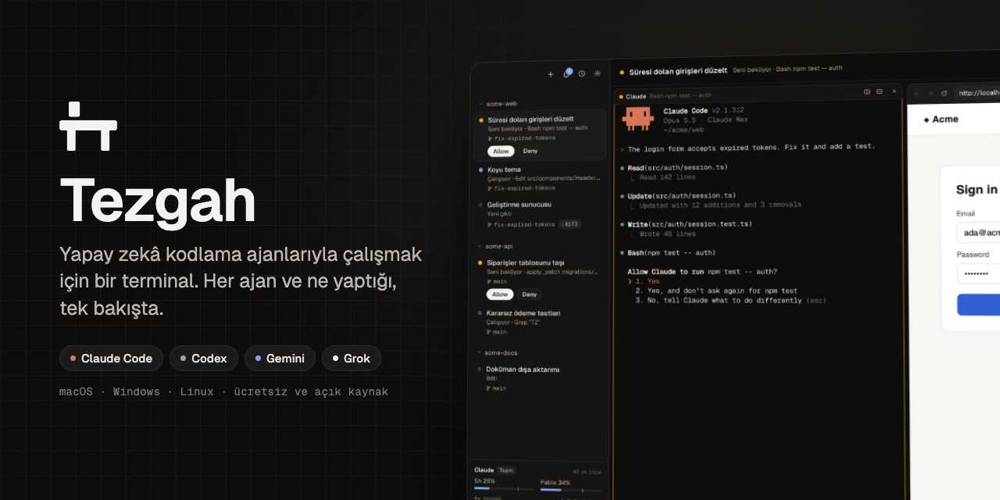
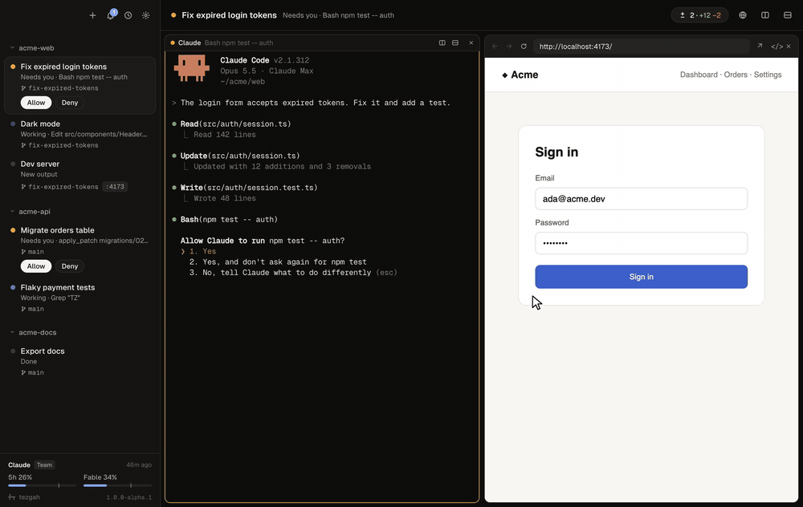
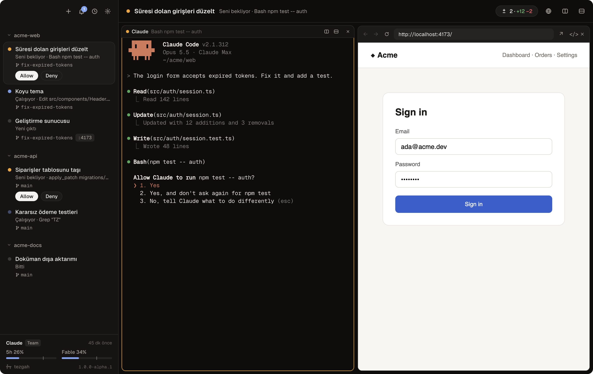
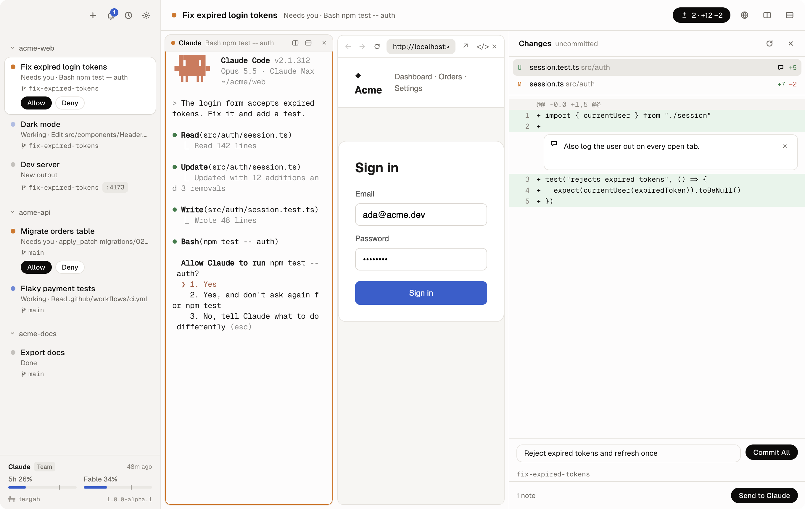
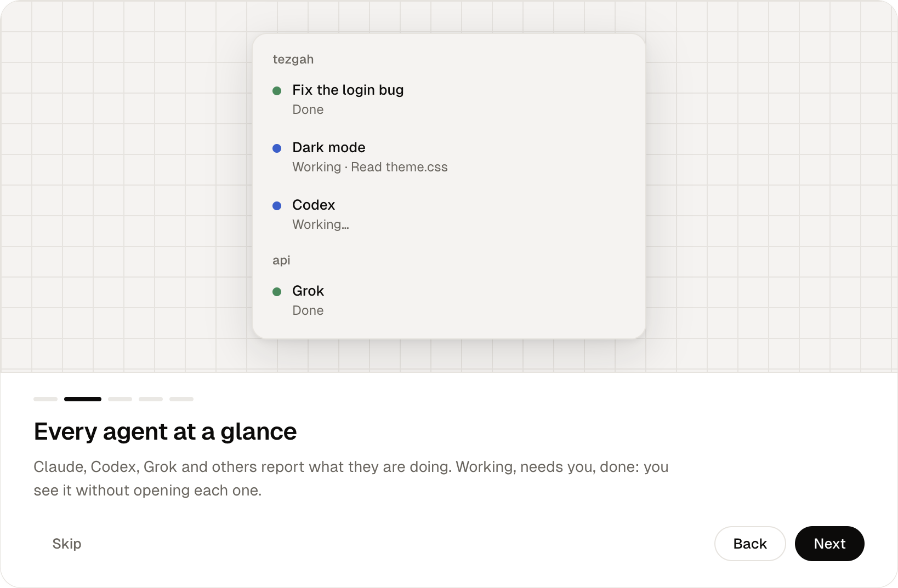

<p align="center"></p>

<p align="center">
  <a href="https://github.com/itsyunusacar/tezgah/releases"></a>
  <a href="https://github.com/itsyunusacar/tezgah/actions/workflows/ci.yml"></a>
  
  <a href="LICENSE"></a>
</p>

<p align="center"><a href="README.md">English</a> · <b>Türkçe</b></p>

**Tezgah**, yapay zekâ kodlama ajanlarıyla çalışmak için bir terminal. Projelerin kenar çubuğunda, her birinde açtığın oturumlarla birlikte duruyor. İçlerindeki her ajan — [Claude Code](https://claude.com/claude-code), Codex, Gemini, Grok ve diğerleri — ne yaptığını gösteriyor: çalışıyor, seni bekliyor, bitti. Aynı anda birkaçını çalıştırıp yine de nereye bakacağını bilirsin.

<p align="center"></p>

<p align="center"><sub><a href="docs/images/demo.mp4">Tam kalitede izle</a></sub></p>

## İndir

| | |
| --- | --- |
| **macOS** | [Apple Silikon (.dmg)](https://github.com/itsyunusacar/tezgah/releases) · [Intel (.dmg)](https://github.com/itsyunusacar/tezgah/releases) |
| **Windows** | [Kurulum (.exe)](https://github.com/itsyunusacar/tezgah/releases) |
| **Linux** | [AppImage](https://github.com/itsyunusacar/tezgah/releases) · [.deb](https://github.com/itsyunusacar/tezgah/releases) |

Sürümler henüz imzalı değil. macOS'te ilk açılışta Uygulamalar klasöründe Tezgah'a sağ tıklayıp *Aç*'ı seç; Windows'ta *Ek bilgi → Yine de çalıştır*. Claude oturumları için [Claude Code](https://claude.com/claude-code) gerekir; kabuk oturumları ve diğer ajanlar onsuz da çalışır. Tezgah ücretsizdir ve hesap istemez.

## Tüm ajanlar bir bakışta



- **Kurulumsuz canlı durum.** Claude Code durumunu kendisi bildirir; Codex, Tezgah içinde çalıştırdığında verilen kancalarla bildirir (kancalara bir kez güvenip güvenmediğini sorar); Gemini, Grok, Aider, OpenCode ve diğerlerinin durumu ne yaptıklarından okunur. Her oturum *Çalışıyor*, *Seni bekliyor* ya da *Bitti* der ve o an ne yaptığını gösterir.
- **Geçiş yapmadan yanıtla.** İzin isteklerine doğrudan kenar çubuğundan izin ver ya da reddet. Seni bekleyen panelin etrafında bir halka çıkar, zil kaçırdıklarını sayar, menü çubuğu simgesi kimin beklediğini gösterir.
- **Alt ajanlar** oturumlarının altında listelenir; her birini çalışırken izleyebilirsin.
- **Nerede ne çalışıyor:** her oturumun git dalı, programlarının dinlediği portlar (tıklayınca açılır) ve PR'ı.
- **Kaldığı yerden devam eden konuşmalar.** Oturumlar Claude konuşmalarına bağlıdır; kabuk panelleri de ekranlarını yeniden açılışta korur.
- **Düzen:** bölünmüş paneller, kaydedilen yerleşimler, paralel ajanlar birbirine karışmasın diye worktree oturumları, sürükleyerek sıralama, sabitleme, arşivleme.
- **Plan limitleri:** Claude ve Codex limitleri kenar çubuğunun altında; her Claude oturumunun bağlamı ve token kullanımı başlığında.

## Ajanlarının kullanabildiği bir tarayıcı

Geliştirme sunucunu terminalin yanında aç. Ajanlar sayfayı öğe numaralarıyla metin olarak okur, tıklar, form doldurur, tuşlara basar, ekran görüntüsü alır, konsolu ve ağ isteklerini kontrol eder; böylece yaptıklarını kendileri dener. Sen başka bir oturuma bakarken de çalışmaya devam eder. Claude bu araçları otomatik alır; diğer ajanlar [`tezgah` komutuyla](#tezgah-komutu) ya da [MCP üzerinden](#ajanlar-ve-tarayıcı) kullanabilir.

## İncele, commit'le, yayınla



Oturumun yaptığı her değişikliği gör, not bırakmak için bir satıra tıkla ve tüm notları Claude'a tek mesajda gönder. Sonra aynı panelden commit'le, gönder ve PR aç.

## Rahat etmen için

<p align="center"></p>

İlk açılışta kısa bir tur; Türkçe ve İngilizce; açık ve koyu tema; terminalde arama; dosya ve ekran görüntülerini sürükleyip bırakarak ya da yapıştırarak yollarını yazma; SSH oturumları; + menüsünde ve hızlı geçişte kendi komutların; değiştirilebilen her kısayol; yeni sürüm çıktığında sessiz bir not.

## Klavye kısayolları

Windows ve Linux'ta Ctrl+harf kombinasyonları kabuğa aittir; bu yüzden Tezgah Ctrl+Shift kullanır. Hepsini Ayarlar → Klavye Kısayolları'ndan değiştirebilirsin.

| İşlem | macOS | Windows / Linux |
| --- | --- | --- |
| Yeni Claude oturumu / kabuk oturumu | ⌘T / ⇧⌘T | Ctrl+Shift+T / Ctrl+Shift+N |
| Worktree'de yeni oturum | ⌥⌘T | Ctrl+Alt+Shift+T |
| Klasör aç / son konuşmalar | ⌘O / ⇧⌘O | Ctrl+Shift+O / Ctrl+Shift+H |
| Oturuma git | ⌘P | Ctrl+Shift+P |
| Seni bekleyen sonraki oturum | ⌘J | Ctrl+Shift+J |
| İzin ver / Reddet | ⇧⌘↩ / ⇧⌘⌫ | Ctrl+Shift+Enter / Ctrl+Shift+Backspace |
| Sağa böl / aşağı böl | ⌘D / ⌥⌘D | Alt+Shift+= / Alt+Shift+- |
| Değişiklikler | ⇧⌘D | Ctrl+Shift+G |
| Paneli / oturumu kapat | ⌘W / ⇧⌘W | Ctrl+Shift+W / Ctrl+Alt+Shift+W |
| 1–9. oturum | ⌘1 … ⌘9 | Alt+1 … Alt+9 |
| Kopyala / yapıştır | ⌘C / ⌘V | Ctrl+Shift+C / Ctrl+Shift+V |
| Bul | ⌘F | Ctrl+Shift+F |
| Bildirimler / son okunmamış | ⌘I / ⇧⌘U | Ctrl+Shift+I / Ctrl+Shift+L |
| Tarayıcıyı aç | ⇧⌘L | Ctrl+Shift+Y |

## Ajanlar ve tarayıcı

Tezgah'ın başlattığı Claude oturumları bu araçları otomatik alır: yalnızca o oturuma verilen bir MCP ayarıyla (Claude ayarların değişmez; Ayarlar'dan kapatılabilir). Claude'a "uygulamayı aç ve giriş formunu kontrol et" dediğinde şunları yapabilir:

| Araç | Ne yapar |
| --- | --- |
| `browser_open` | Oturumun tarayıcı panelinde bir adres açar ve yüklenmesini bekler |
| `browser_snapshot` | Sayfayı metin olarak verir; her bağlantı, düğme ve alanın bir numarası olur (`e12`) |
| `browser_click`, `browser_fill`, `browser_type`, `browser_press`, `browser_select`, `browser_hover`, `browser_scroll` | Gerçek fare ve klavye girdisiyle sayfada işlem yapar |
| `browser_screenshot` | Sayfayı ya da bir öğeyi resim olarak gösterir |
| `browser_wait` | Bir metni, seçiciyi, adresi ya da yüklenmeyi bekler |
| `browser_console`, `browser_network` | Sayfanın konsol kayıtları ve yaptığı istekler (başarısızlar dahil) |
| `browser_eval`, `browser_navigate` | JavaScript çalıştırır; geri, ileri, yenile |
| `terminal_read`, `terminal_send`, `terminal_split` | Diğer panelleri okur ya da onlara yazar; yanına bir geliştirme sunucusu açar |
| `tezgah_list`, `tezgah_notify` | Oturumlar ve paneller; sana bildirim |

**Diğer ajanlar** da aynı araçları kullanabilir. Kabuk komutu çalıştırabilen her ajan aşağıdaki `tezgah` komutunu kurulumsuz kullanır. MCP destekleyen ajanlar için `tezgah mcp`'yi sunucu olarak ekle:

```toml
# Codex: ~/.codex/config.toml
[mcp_servers.tezgah]
command = "tezgah"
args = ["mcp"]
```

```json
// Gemini CLI: ~/.gemini/settings.json
{ "mcpServers": { "tezgah": { "command": "tezgah", "args": ["mcp"] } } }
```

`tezgah` komutu yalnızca Tezgah'ın terminallerinde bulunur; bu yüzden bu sunucular ajan Tezgah içinde çalışırken başlar.

## `tezgah` komutu

Tezgah'ın içindeki her terminalde bir `tezgah` komutu vardır. Hiçbir şey kurmaz; Tezgah'ın kendi çalışma ortamıyla çalışır ve uygulamayla yalnızca senin kullanıcının açabildiği bir soket üzerinden konuşur.

```sh
tezgah browser open http://localhost:5173    # uygulamanı terminalin yanında aç
tezgah browser snapshot                      # sayfa metin olarak, numaralarıyla
tezgah browser fill text=Email ada@example.com
tezgah browser click "text=Sign in"          # bir numara (e12), CSS seçici ya da text=…
tezgah browser wait --text "Welcome"
tezgah browser screenshot                    # PNG dosyasının yolunu yazar
tezgah browser console --errors              # ayrıca: network --failed, eval <js>, press Enter
tezgah notify --title Derleme "testler geçti" # bildirim, halka ve panel kaydı
tezgah status working "yayınlanıyor"         # bu panelin kenar çubuğundaki durumu
tezgah split down -- npm run dev             # bunun yanında bir komut çalıştıran yeni panel
tezgah new --shell --dir ~/code/api -- make  # yeni oturum
tezgah send --enter "testleri tekrar çalıştır" # bu oturumun Claude'una yaz
tezgah read --lines 50                       # bir panelin gösterdiği
tezgah list                                  # oturumlar ve paneller
tezgah run "Dev server"                      # kendi komutlarından biri
```

`tezgah help` hepsini listeler.

## Kaynaktan derleme

Node 22+ gerekir (Linux'ta yerel modüller için olağan derleme araçları da).

```sh
git clone https://github.com/itsyunusacar/tezgah.git
cd tezgah
npm install
npm run dev          # canlı yenilemeyle çalıştır
npm test             # birim testleri
npm run e2e          # uçtan uca testler
npm run dist         # sistemin için kurulum dosyaları, dist/ içinde
```

Electron, [xterm.js](https://xtermjs.org) ve [node-pty](https://github.com/microsoft/node-pty); arayüz React ile.

## Gizlilik

Tezgah'ta telemetri ve hesap yok. İki tür ağ isteği yapar. Yeni sürümleri haber vermek için açılışta ve altı saatte bir GitHub'dan bu deponun son sürümlerini sorar (Ayarlar → Güncellemeleri denetle ile kapatılır; kendiliğinden hiçbir şey kurulmaz). Plan limitlerini göstermek için Claude Code'un giriş bilgisini okur (macOS'te Anahtar Zinciri'ndeki `Claude Code-credentials`, diğer sistemlerde `~/.claude/.credentials.json`) ve Claude Code'un `/usage` komutunun kullandığı `https://api.anthropic.com/api/oauth/usage` adresini çağırır. Bu adres belgelenmemiştir ve çalışmayı bırakabilir.

Codex limitleri için Codex'in kendi oturum kayıtlarındaki (`~/.codex/sessions`) son raporu okur; hiçbir yere bir şey gönderilmez. Diğer ajanlar (Gemini CLI, Cursor, OpenCode) limitlerini bilgisayarında tutmadığı için Tezgah onları gösteremez.

Konuşmaları devam ettirmek, son konuşmaları listelemek ve alt ajanları izlemek için `~/.claude/projects` klasörünü okur. Projelerin, oturumların ve her kabuk panelinin son ekranı Tezgah'ın kendi ayar klasöründe saklanır. GitHub CLI kuruluysa, projelerinin PR'larını göstermek için `gh pr view` çalıştırır; bu senin `gh` girişini kullanır.

Tezgah bağımsızdır ve Anthropic ile bağlantılı değildir. Claude ve Claude Code, Anthropic'in ticari markalarıdır.

## Lisans

[MIT](LICENSE)
