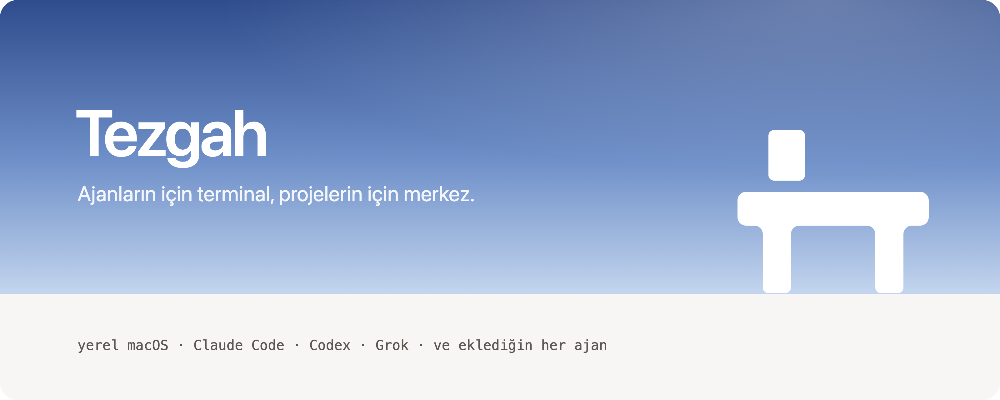
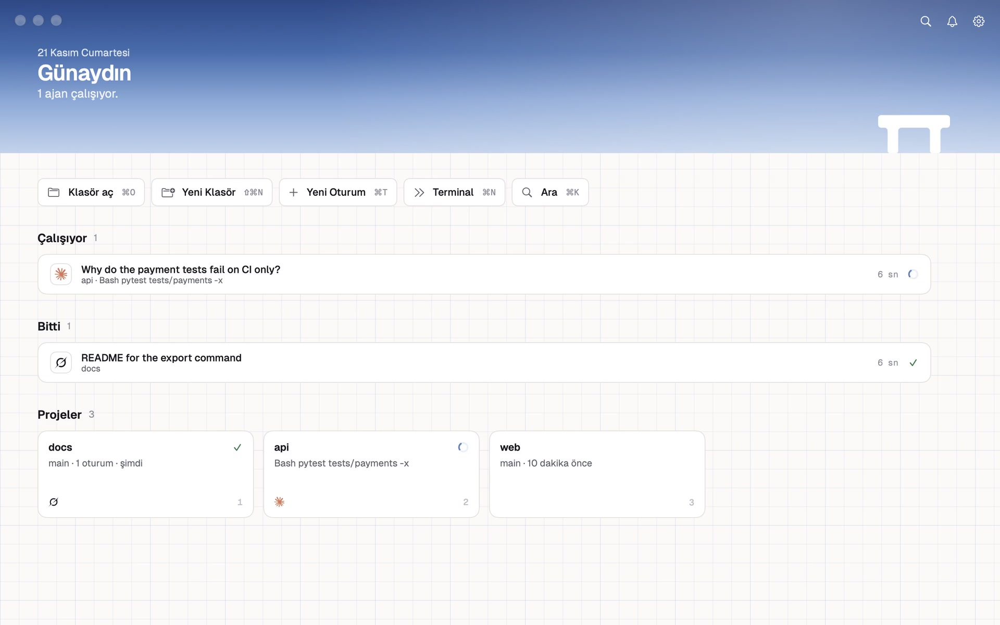
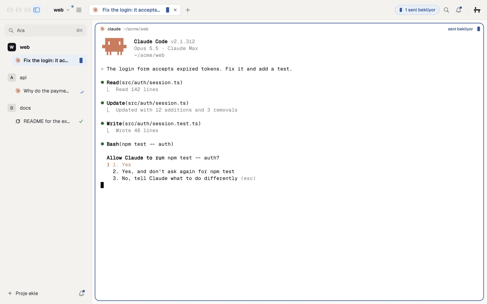
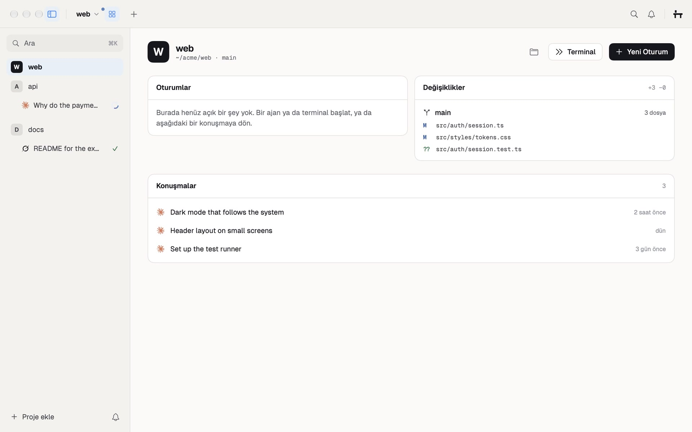
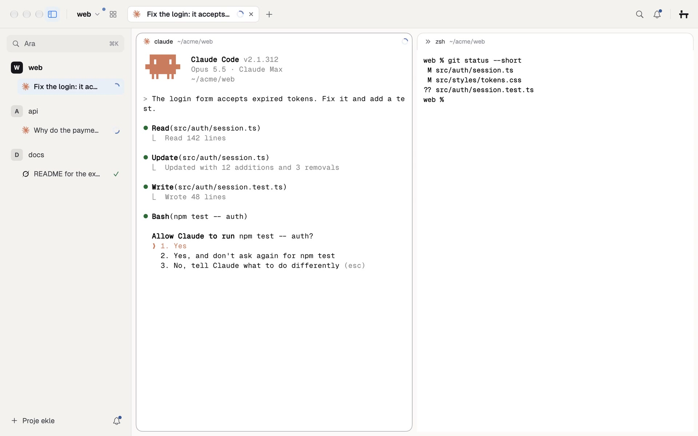

  
  
  
  

<a href="README.md">English</a> · <b>Türkçe</b> · <a href="https://tezgah.itsyunusacar.com/tr">Web sitesi</a>

Tezgah, yapay zekâ kodlama ajanlarıyla çalışmak için yapılmış yerel bir Mac terminalidir. Çalıştığın bütün projeler, içlerinde açık olan oturumlarla birlikte tek pencerede durur; her ajan ne yaptığını söyler: çalışıyor, seni bekliyor, bitti. İçinde olduğun projeden çıkmadan başka bir projede ajan başlatırsın, ertesi gün aynı konuşmalara dönersin.

**Tezgah beta aşamasında.** Sık güncellenir; bozulan bir şey görürsen [Issues](https://github.com/itsyunusacar/tezgah/issues) sayfasına yaz.

<a href="docs/media/demo-tr.mp4">Tam kalitede izle</a> · 32 saniye

## İndir

**[macOS için Tezgah](https://github.com/itsyunusacar/tezgah/releases/latest)** · macOS 15 ve sonrası · Apple silicon ve Intel · ücretsiz, hesap gerektirmez.

Zip dosyasını aç, Tezgah'ı Uygulamalar'a taşı. Sürüm henüz Apple tarafından onaylanmadı (notarize edilmedi); bu yüzden ilk seferde Tezgah'a sağ tıklayıp *Aç*'ı seç. Sonrasında kendini günceller.

Ajanları sen getirirsin: [Claude Code](https://claude.com/claude-code), [Codex](https://developers.openai.com/codex/cli), [Grok](https://x.ai/cli) ya da komut satırından çalışan başka bir ajan. Kabuk oturumları hiçbiri olmadan da çalışır.

## Bütün projeler tek pencerede

- **Ana sayfa** ilk açılan yerdir: bütün projelerinde kim seni bekliyor, kim çalışıyor, kim bitirdi.
- **Kenar çubuğu** oturumun yanında bütün projeleri, oturumlarını ve durumlarını listeler. Sırası senin verdiğin gibi kalır.
- **Her yerden başlat.** Yeni oturum seçicisi (⌘T) herhangi bir projede ajan başlatır; kendi sekmesinde ya da içinde olduğun oturumun yanında.
- **Olduğun yerden yanıtla.** Çubuktaki rozet kaç ajanın beklediğini gösterir; ⌘J seni sıradakine götürür.

## Ajanlar

| | Seçiciden başlar | Durum | Konuşmasına döner |
| --- | --- | --- | --- |
| **Claude Code** | evet | kendisi bildirir | evet |
| **Grok** | evet | kendisi bildirir | evet |
| **Codex** | evet | o çalıştırmaya özel bir kancayla | evet (yeni, az denendi) |
| **Diğer her şey** (Aider, OpenCode, Gemini CLI, Cursor Agent…) | Ayarlar › Ajanlar'dan eklenince | ekranda yaptıklarından okunur | yeni başlar |

Tezgah hiçbir ajanın kendi ayarlarını değiştirmez. Kanca eklediği yerde kanca yalnızca o çalıştırma için verilir.

## Konuşmalar projeyle birlikte durur

Her projenin bir panosu vardır (⇧⌘B): açık oturumları, git çalışma ağacında değişenler ve ajanların o klasörde yaptığı bütün konuşmalar. Birine tıkla, kaldığı yerden devam et.

Ajanlar açıkken Tezgah'tan çıkarsan döndüğünde yerlerindedirler: her bölme, oturumunu açtığında ajanını aynı konuşmada yeniden başlatır. İlk mesajlar ve tek seferlik komutlar ikinci kez yazılmaz.

## Önce bir terminal

- [Ghostty](https://ghostty.org)'nin çizim motoruyla: hızlı; ligatürler, gerçek renk ve modern araçların beklediği klavye protokolleriyle.
- Alanı eşit paylaşan, sayıları artınca kendini ızgaraya dizen bölmeler (⌘D, ⇧⌘D).
- Aydınlık ve karanlık 16 tema, geçmişte arama (⌘F), her şey için ⌘K paleti.
- Finder'da klasöre sağ tık › *Tezgah'ta Aç*; betikler ve `ssh://` bağlantıları için varsayılan terminal yapabilirsin.
- Türkçe ve İngilizce.

## Kısayollar

| | |
| --- | --- |
| Yeni oturum · Yeni terminal | ⌘T · ⌘N |
| Sağa böl · aşağı böl · Izgaraya diz | ⌘D · ⇧⌘D · ⇧⌘G |
| Sonraki / önceki bölme | ⌥⌘→ · ⌥⌘← |
| Sonraki / önceki oturum | ⌃⇥ · ⌃⇧⇥ |
| Bekleyen sıradaki ajan | ⌘J |
| Her şeyi ara · Hızlı geçiş | ⌘K · ⌘P |
| Kenar çubuğu · Proje panosu · Ana sayfa | ⌘0 · ⇧⌘B · ⇧⌘H |

## Gizlilik

Tezgah hiçbir yere hiçbir şey göndermez: analiz yok, hesap yok. İki izin ister, bildirimler ve Finder eylemi; ikisi olmadan da çalışır.

## Kaynaktan derleme

Derleme adımları ve kodun yapısı için [İngilizce README](README.md#build-from-source)'ye bak.

## Lisans

[MIT](LICENSE). Geist ve Geist Mono [SIL Open Font License](Sources/Tezgah/Resources/Fonts/OFL-Geist.txt) altındadır.
